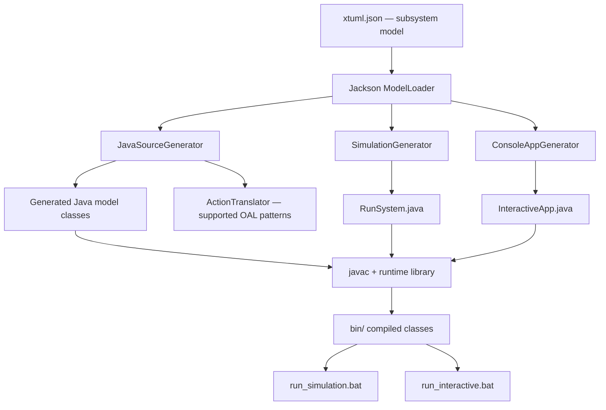
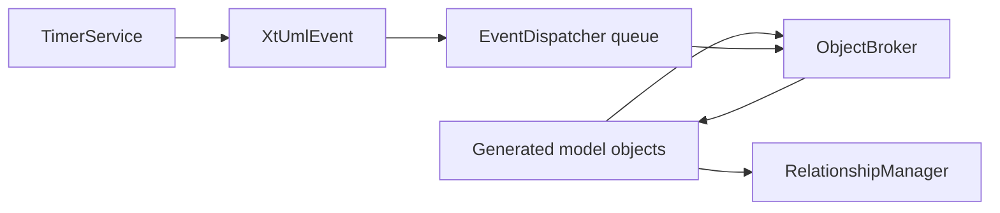

# xtUML to Java Compiler

**A Java-based model-to-code compiler and executable simulation prototype for JSON-defined xtUML concepts.**

This project reads a structured `xtuml.json` model, converts classes and a subset of **Object Action Language (OAL)** into Java source files, and generates both an **automatic simulation runner** and an **interactive console application**. A small in-memory runtime manages object instances, relationships, events, and timers.

The included example models a **PlayStation rental business** with `Customer`, `PSConsole`, `Rate`, and `Rental` entities.

> **Status: educational compiler prototype.** It demonstrates source generation and runtime concepts; it is **not a standards-complete xtUML/OAL compiler** or a production-ready Java application generator. OAL translation is primarily pattern-based, the interactive console has a rental-specific mode, and generated code must be compiled and tested for each input model.

**Core technologies:** Java 17+ · Jackson 2.15.2 · JSON · Object Action Language subset · Windows batch scripts

## What it does

The compiler implements the following pipeline:



| Component | Implemented role |
| --- | --- |
| Model loading | Read the JSON subsystem and deserialize class/association elements with Jackson |
| Class generation | Generate Java classes, attributes, getters/setters, constructors, and type mappings |
| State machines | Generate state enums, event constants, event-driven transitions, and state action methods |
| OAL translation | Translate selected statements such as selection, relation operations, assignments, conditions, loops, events, and logging |
| Relationship handling | Represent links between in-memory instances, including an optional associative object |
| Runtime events | Queue and dispatch events to model instances; support timer-triggered events |
| Automatic simulation | Create sample instances, connect association pairs, and dispatch selected test events |
| Interactive console | Generate a generic model-management console or a tailored PlayStation rental console |

## Quick start

### Prerequisites

- **Windows** (the provided runners are `.bat` files using Windows commands and classpath separators).
- **JDK 17 or later**, with both `java` and `javac` available on your `PATH`.
- The **Jackson 2.15.2** JARs in `lib/`. This repository already includes `jackson-core`, `jackson-databind`, and `jackson-annotations`.

No Maven or Gradle build is configured. Run the commands **from the repository root**, because the compiler opens `xtuml.json` using a relative path.

### 1. Clone

```bat
git clone https://github.com/alfrzhb/compiler-xtuml-to-java.git
cd compiler-xtuml-to-java
java -version
javac -version
```

### 2. Build and generate

```bat
run_compiler.bat
```

The script:

1. Recreates `out/` and collects source files from `src/`.
2. Compiles the compiler and runtime using `javac` and the bundled Jackson libraries.
3. Runs `com.xtuml.compiler.Main`, which reads `xtuml.json` and writes generated Java sources into `src-gen/`.
4. Compiles runtime and generated sources into `bin/`.

**Expected artifacts include:**

```text
out/com/xtuml/compiler/...                Compiled compiler classes
src-gen/com/xtuml/generated/Customer.java
src-gen/com/xtuml/generated/PSConsole.java
src-gen/com/xtuml/generated/Rate.java
src-gen/com/xtuml/generated/Rental.java
src-gen/com/xtuml/generated/InteractiveApp.java
src-gen/RunSystem.java
bin/                                    Compiled simulation/runtime classes
```

These paths reflect the checked-in **PlayStation rental example**, not the guaranteed output of every custom model.

If the Jackson files are missing or corrupted, `setup_libs.bat` downloads the three specific JAR versions using PowerShell and Maven Central. It is **optional when the bundled libraries are intact** and needs network access when used.

### 3. Run the automatic simulation

```bat
run_simulation.bat
```

This launches `RunSystem` from `bin/`. For the input model, the generated runner is designed to:

- Instantiate one example object for each declared class.
- Set some representative attribute values.
- Link instances according to two-ended associations.
- Enqueue selected state events and process the event queue.

This is a **generated demonstration/smoke scenario**, not an exhaustive correctness test of all associations, state transitions, or business rules.

### 4. Run the interactive console

```bat
run_interactive.bat
```

This launches `com.xtuml.generated.InteractiveApp`. With the bundled rental model, the generator detects the combination of `Customer`, `PSConsole`, and `Rental` and builds a **rental-oriented menu**.

The rental menu offers operations such as:

- Creating a rental.
- Recording a unit return.
- Checking console availability.
- Entering an admin mode for managing generated model instances and events.

For other models, `ConsoleAppGenerator` takes a **generic model-management menu** path. The specialized rental workflow should not be advertised as a fully generic business-rule generator.

**Example walkthrough:** [`docs/demo_flow.md`](docs/demo_flow.md). Treat the example steps as a demo guide; runtime execution has not been revalidated in this README audit.

## Input model: `xtuml.json`

The input file is a JSON representation of a subsystem, not an XMI export or a full UML interchange format.

A simplified model looks like this:

```json
{
  "type": "subsystem",
  "sub_id": "s1",
  "sub_name": "demo",
  "model": [
    {
      "type": "class",
      "class_id": "1",
      "class_name": "Customer",
      "KL": "Cst",
      "attributes": [
        {
          "attribute_type": "descriptive_attribute",
          "attribute_name": "name",
          "data_type": "string"
        }
      ]
    }
  ]
}
```

### Supported model elements

| JSON field | Interpretation |
| --- | --- |
| `type: "subsystem"` | Root model type |
| `sub_id` / `sub_name` | Subsystem identification |
| `model[]` | Array of class and association elements |
| `type: "class"` | Class definition with `class_id`, `class_name` and optional `KL` |
| `attributes[]` | Attributes, naming/referential/descriptive roles, data types, optional defaults |
| `states[]` | Named states, triggering `state_event[]` values and optional action strings |
| `operations[]` | Additional methods with a return type and OAL-like action strings |
| `supertype` | Optional Java superclass name for a generated class |
| `type: "association"` | Named relation (for example `R1`) between class endpoints and multiplicities |

The model currently bundled in `xtuml.json` declares **four classes and three associations (R1–R3)**.

### Type mapping

| Model type | Java type |
| --- | --- |
| `integer` | `int` |
| `real` / `decimal` | `double` |
| `string` | `String` |
| `boolean` | `boolean` |
| `id` | `UUID` |
| `datetime` | `LocalDateTime` |
| `state` | `String` (plus a generated enum when states are declared) |

This mapping is implemented by `JavaSourceGenerator`. Unknown model types currently fall back to `String`.

**Full input reference:** [`docs/req-xtuml.md`](docs/req-xtuml.md) and [`docs/xtuml.md`](docs/xtuml.md).

To try a different model, replace `xtuml.json` with a compatible structure and rerun `run_compiler.bat`. The entry point currently uses a **hardcoded input filename**, not a command-line `--input` argument. Use valid Java identifiers for generated names and review the resulting code before trusting it.

## OAL translation

`ActionTranslator` recognizes a **subset of OAL-like statements** through regular-expression patterns. Representative syntax includes:

```text
select any c from instances of Customer where name == "Bob"
select many customers from instances of Customer
create object instance c of Customer
relate c to rental across R1
unrelate c from rental across R1
select one rental related by c->Rental[R1]
if (count > 5)
end if
for each item in items
end for
create timer t event setAvailable to self delay 3600
Bridge::log("Processing rental")
```

Translations target runtime types such as `ObjectBroker`, `RelationshipManager`, `EventDispatcher`, and `TimerService`.

**Scope matters:** this translator is not a complete OAL parser or type checker. Unrecognized lines can become comments of the form `// Could not translate: ...`, and certain event forms (including class/creator events) are emitted as log messages rather than full runtime behavior. Complex expressions, names, scoping, and generated Java compilability require case-by-case verification.

The repository also has [`docs/OAL.md`](docs/OAL.md), which lists a **52-item implementation checklist**. That checklist is a project-maintained coverage claim, **not independently verified standards compliance or a passing 52-test suite**.

## Runtime design



- **`BaseModel`:** UUID identity, logical deletion flag, and an overridable event handler.
- **`ObjectBroker`:** in-memory instance registry and lookup by UUID or class.
- **`RelationshipManager`:** in-memory links and relationship navigation.
- **`XtUmlEvent`:** event target, identifier, and payload.
- **`EventDispatcher`:** FIFO-style event queue and delivery to a registered model instance.
- **`TimerService`:** delayed event submission to the runtime.

The runtime is **memory-resident only**. It has no SQL database, persistence layer, distributed event broker, or durable timer scheduler. Restarting the generated console does not restore previous in-memory objects.

## Repository layout

```text
compiler-xtuml-to-java/
├── README.md
├── xtuml.json                     # Included rental model
├── run_compiler.bat               # Compile compiler and generated code
├── run_simulation.bat             # Execute RunSystem
├── run_interactive.bat            # Execute generated InteractiveApp
├── setup_libs.bat                 # Optional Jackson JAR download
├── src/com/xtuml/
│   ├── compiler/
│   │   ├── Main.java              # Entry point (reads xtuml.json)
│   │   ├── ModelLoader.java       # Jackson deserialization
│   │   ├── JavaSourceGenerator.java
│   │   ├── ActionTranslator.java
│   │   ├── SimulationGenerator.java
│   │   ├── ConsoleAppGenerator.java
│   │   └── model/                 # JSON metamodel classes
│   └── runtime/                   # ObjectBroker, events, relations, timers
├── src-gen/                       # Generated Java sources
├── out/                           # Compiled compiler classes
├── bin/                           # Compiled simulation/runtime classes
├── lib/                           # Bundled Jackson JARs
└── docs/                          # Specifications and demonstration notes
```

The repository currently checks in some generated `src-gen/` files and compiled `.class` artifacts. Treat them as **snapshots**, not proof that the latest generator can recreate them without errors.

## Known limitations and development priorities

1. **Input and platform coupling:** `Main.java` reads `xtuml.json` from the working directory; the supplied runners target Windows. There is no portable build/CLI interface.
2. **Not fully generic:** the interactive console includes a deliberate PlayStation rental special case; other models receive a generic menu.
3. **Pattern-driven OAL compiler:** regex-based translation is narrower than a real parser with an AST, semantic analysis, and robust type checking.
4. **Partial error propagation:** `Main.java` catches and prints generation exceptions rather than necessarily returning a nonzero process exit code. The batch pipeline should fail fast if generation fails instead of risking stale or partially generated files.
5. **Simulation is illustrative:** one sample instance per class and selected events do not amount to complete state-machine or association testing.
6. **Event ID strategy:** constants are derived from a reduced Java string hash; different event names could collide. Collision detection would improve reliability.
7. **Validation is limited:** the generator checks duplicate class names, but comprehensive validation of identifiers, types, references, multiplicities, and OAL semantics is not established.
8. **No established automated regression suite:** project verification messages and generated outputs exist, but no standard unit-test/CI pipeline was identified from the source tree.
9. **No persistence:** model instances and relationships are in memory.
10. **No root license file:** a specific open-source license cannot be inferred from this repository.

### Recommended next steps

- Add a cross-platform build (Gradle/Maven) and a CLI accepting input/output paths.
- Replace regex-only OAL rewriting with tokenization, parsing, and typed semantic checks.
- Add model validation, event ID collision detection, and clean failure codes.
- Add unit tests for source generation and golden-file tests for representative JSON models.
- Compile and execute generated code in CI, including state transitions, relationships, and failure cases.
- Separate the generic interactive generator from the rental demo extension.

## More documentation

- [JSON metamodel specification](docs/req-xtuml.md)
- [xtUML modeling notes](docs/xtuml.md)
- [OAL translation implementation notes](docs/OAL.md)
- [Batch scripts reference](docs/bat.md)
- [Rental demo walkthrough](docs/demo_flow.md)
- [Criteria and verification checklist](docs/criteria_analysis.md)

> **Verification note:** this README was prepared from the checked-in source files and scripts. Java compilation, simulation execution, and the documented demo walkthrough were **not rerun** during this documentation-only update.

---

**Repository:** [alfrzhb/compiler-xtuml-to-java](https://github.com/alfrzhb/compiler-xtuml-to-java) · **Default branch:** `main`
